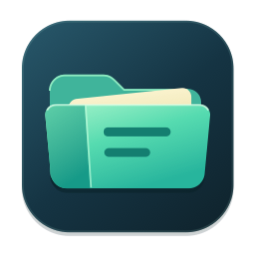
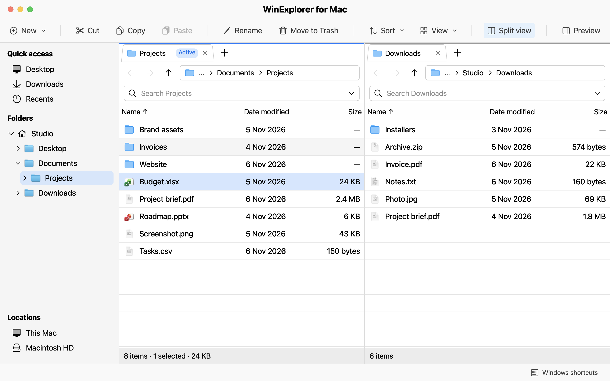

<p align="center">
  
</p>
<h1 align="center">WinExplorer for Mac</h1>
<p align="center"><strong>The familiar layout and keyboard shortcuts of Windows File Explorer, built for macOS.</strong></p>

WinExplorer for Mac runs alongside Finder. Browse with a folder tree and an editable address bar, open two folders side by side to move files between them, or preview the selected file in a single pane.

**[Download for Apple silicon (ZIP)](https://github.com/anas-debug-again/winexplorer-for-mac/releases/download/v0.7.3/WinExplorer-for-Mac-v0.7.3-macos-arm64.zip)** · Version 0.7.3 · macOS 14 or later

Unzip the download and drag **WinExplorer for Mac.app** into Applications. The download uses an ad hoc signature and ships without Apple notarization, so macOS may block the first launch.



## Build and run

Version **0.7.3** requires **macOS 14 or later** and **Swift 6.0 or later**. Xcode or the Xcode Command Line Tools supply the compiler. The app uses AppKit and the system SQLite library and builds without external Swift packages.

```sh
git clone https://github.com/anas-debug-again/winexplorer-for-mac.git
cd winexplorer-for-mac
./scripts/build.sh
./scripts/run.sh
```

The build creates `build/WinExplorer for Mac.app` and signs it locally with an ad hoc signature. You can open that bundle directly from Finder. Quit the app before rebuilding it.

## Working with files

- **Navigation.** Each pane has its own tabs and history. Use the folder tree to browse, click a breadcrumb to jump to a parent, or press `Ctrl+L` to enter a path.
- **Transfers.** Copy, cut, paste, or drag between folders. Follow each transfer’s progress and choose **Keep Both**, **Replace**, or **Skip** when names collide.
- **Views.** Switch between Details, List, Tiles, and icon sizes. Customize columns and grouping, preview a selection, or open Properties to calculate a folder’s size.
- **Shortcuts and recent folders.** Use **Paste shortcut** or **Send to → Desktop** to make a `.fmlink` shortcut. Open a folder shortcut in a new window, or reopen one of your last three folders from the Dock menu.

### Filename search

Press `Ctrl+F` and type part of a filename. By default, the search includes subfolders. Its first pass builds a local catalog in the background. Later searches reuse the catalog, and filesystem changes update it. To limit the search to the open directory, choose **This folder** in the search field’s scope menu.

**Best match** puts exact names first, followed by names that start with your query and then other matches. Each result shows its parent location. **Show More** loads the next 1,000 matches. You can also exclude caches and generated folders from the results.

The index stores filenames, paths, and file attributes for the locations you search. File contents stay outside the index. The app stores the index, saved tabs, preferences, and recent-folder history in `~/Library/Application Support/File Manager/`, the directory used by earlier builds.

### Keyboard shortcuts

The shortcuts shown with `Ctrl` also work with `Command`.

| Action | Shortcut |
| --- | --- |
| Copy / cut / paste | `Ctrl+C` / `Ctrl+X` / `Ctrl+V` |
| Select all | `Ctrl+A` |
| Edit the address / search filenames | `Ctrl+L` / `Ctrl+F` |
| Open a new window | `Ctrl+N` |
| Open / close a tab | `Ctrl+T` / `Ctrl+W` |
| Create a folder | `Ctrl+Shift+N` |
| Rename / move to Trash | `F2` / `Delete` |
| Open Properties | `Ctrl+I` or `Option+Return` |
| Preview | `Space` |
| Refresh | `Ctrl+R` |
| Toggle split view | `Command+Shift+S` |

## Development

```sh
BUILD_CONFIGURATION=debug ./scripts/build.sh
./scripts/test.sh
./scripts/test-ui.sh
```

The UI harness also accepts individual suite names. To exercise just filename search and rectangle selection, run `./scripts/test-ui.sh BrowserSearch MarqueeSelection`. To benchmark search using generated test data, run `./scripts/benchmark-search.sh --counts 100000 --real-files 1000 --queries 20`.

| Location | Contents |
| --- | --- |
| `Sources/MacFileManager/` | AppKit windows, browser panes, menus, and previews |
| `Sources/FileManagerCore/` | File operations, transfers, metadata, and search |
| `Sources/FileManagerDockPlugin/` | Dock menu available while the app is closed |
| `Tests/` | Core tests and native UI regressions |
| `scripts/` | Build, test, benchmark, and sample-data tools |

Issues and pull requests are welcome. For a bug report, include your macOS version, steps to reproduce the issue, and what you expected to happen. Sample filenames make reports easier to share.

## License

WinExplorer for Mac is an independent open-source project. The source code and original app icon are available under the [MIT License](LICENSE).
